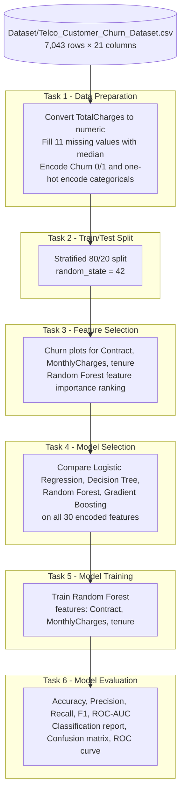

<div align="center">

# 📉 Customer Churn Analysis and Prediction

### Machine Learning Internship Project — Saiket Systems

Predicting which telecom customers are likely to leave, using the Telco Customer Churn dataset.


</div>

---

## 📑 Table of Contents

1. [Project Overview](#-project-overview)
2. [Objectives](#-objectives)
3. [Key Features](#-key-features)
4. [Internship Task Coverage](#-internship-task-coverage)
5. [Workflow](#-workflow)
6. [Dataset](#-dataset)
7. [Methodology](#-methodology)
8. [Results](#-results)
9. [Business Insights](#-business-insights)
10. [Project Structure](#-project-structure)
11. [Technology Stack](#-technology-stack)
12. [Installation and Setup](#-installation-and-setup)
13. [How to Run](#-how-to-run)
14. [Troubleshooting](#-troubleshooting)
15. [Limitations](#-limitations)
16. [Future Improvements](#-future-improvements)
17. [License](#-license)
18. [Author](#-author)

---

## 📌 Project Overview

**Customer churn** is when a customer stops using a company's service. In a subscription business such as telecommunications, losing a customer means losing recurring revenue, and acquiring a replacement customer usually costs more than keeping an existing one. Understanding *who* is likely to leave, and *why*, lets a business act before it is too late.

This project analyses churn in a telecommunications company and builds machine learning models that estimate which customers are at risk of leaving. It was completed as part of the **Machine Learning Internship at Saiket Systems**, and follows the six-task brief provided by the internship program (see [Internship Task Coverage](#-internship-task-coverage)).

**How machine learning helps:** a classifier learns patterns from historical customers (their contract, tenure, charges, services, and whether they eventually churned). It can then output a churn prediction or a churn probability for each customer, so a retention team can prioritise outreach instead of contacting everyone.

---

## 🎯 Objectives

- Load, clean and prepare the Telco Customer Churn dataset for machine learning.
- Create a representative 80% / 20% train–test split.
- Identify features that influence churn (contract type, monthly charges and tenure, as highlighted in the brief).
- Compare candidate binary classifiers: Logistic Regression, Decision Tree, Random Forest and Gradient Boosting.
- Train a churn classifier with `Churn` as the target variable.
- Evaluate it on held-out data using accuracy, precision, recall, F1-score and ROC-AUC.

---

## ✨ Key Features

- **Six self-contained Jupyter notebooks**, one per internship task, each in its own folder.
- **Robust dataset loading:** every notebook searches upward from its own folder to find `Dataset/`, so notebooks work when opened from inside their task folder.
- **Stratified 80/20 split** with `random_state=42`, which keeps the churn ratio nearly identical in the training and test sets.
- **Four-model comparison** on one shared split, with accuracy, precision, recall, F1-score and ROC-AUC.
- **Class-imbalance awareness:** `class_weight="balanced"` is used for Logistic Regression, Decision Tree and Random Forest.
- **Full evaluation output:** metrics table, classification report, confusion matrix and ROC curve.

---

## ✅ Internship Task Coverage

The original Saiket Systems brief lists six tasks (and notes that a minimum of 4 of 6 must be completed). This project contains a notebook for **all six**.

| # | Official task title | Brief description (from the task PDF) | What was implemented | Notebook |
|---|---|---|---|---|
| 1 | **Data Preparation** | Load and preprocess the dataset, address missing values, encode categorical variables | Loads the CSV, checks duplicates and dtypes, converts `TotalCharges` from text to numeric, fills missing values with the median, encodes `Churn` as 0/1, one-hot encodes categorical inputs | [`Task_1/Task_1_Data_Preparation.ipynb`](Task_1/Task_1_Data_Preparation.ipynb) |
| 2 | **Split Data for Training and Testing** | 80% train / 20% test, representative split | Stratified `train_test_split` (`test_size=0.20`, `random_state=42`), verifies churn share and column consistency | [`Task_2/Task_2_Train_Test_Split.ipynb`](Task_2/Task_2_Train_Test_Split.ipynb) |
| 3 | **Feature Selection** | Select relevant features such as contract type, monthly charges and tenure | Visualises churn against `Contract`, `MonthlyCharges` and `tenure`; ranks all encoded features with Random Forest feature importance | [`Task_3/Task_3_Feature_Selection.ipynb`](Task_3/Task_3_Feature_Selection.ipynb) |
| 4 | **Model Selection** | Choose a suitable binary classifier (logistic regression, decision trees, random forests or gradient boosting) | Trains and compares all four candidates on the same split using all 30 encoded features; reports metrics and a confusion matrix for the highest ROC-AUC model | [`Task_4/Task_4_Model_Selection.ipynb`](Task_4/Task_4_Model_Selection.ipynb) |
| 5 | **Model Training** | Train the selected model on the training set, with chosen features as input and `Churn` as target | Trains a `RandomForestClassifier` (300 trees) on `Contract`, `MonthlyCharges` and `tenure`; shows feature importances | [`Task_5/Task_5_Model_Training.ipynb`](Task_5/Task_5_Model_Training.ipynb) |
| 6 | **Model Evaluation** | Assess performance on the test set with accuracy, precision, recall, F1-score and ROC-AUC | Rebuilds the same split, retrains the Random Forest, and reports all five metrics, a classification report, a confusion matrix and a ROC curve | [`Task_6/Task_6_Model_Evaluation.ipynb`](Task_6/Task_6_Model_Evaluation.ipynb) |

> **Note on model choice.** In Task 4, **Gradient Boosting** (all 30 features) has the highest test ROC-AUC (0.8425). Tasks 5 and 6 use a **Random Forest** trained on the three features named in the task brief (`Contract`, `MonthlyCharges`, `tenure`). Both sets of results are reported below exactly as produced by the notebooks.

---

## 🔄 Workflow

Each notebook is **self-contained**: it reloads the dataset and recreates the steps it needs, rather than reading files produced by an earlier notebook.



---

## 📊 Dataset

**File:** [`Dataset/Telco_Customer_Churn_Dataset.csv`](Dataset/Telco_Customer_Churn_Dataset.csv)

### Verified dimensions and target

| Property | Value |
|---|---|
| Rows (customers) | **7,043** |
| Columns | **21** (20 descriptive columns + the `Churn` target) |
| Unique `customerID` values | 7,043 |
| Duplicate rows | 0 |
| Target variable | `Churn` (`Yes` / `No`), encoded as `Yes = 1`, `No = 0` |

### Class distribution

| Class | Customers | Share |
|---|---|---|
| No churn (0) | 5,174 | 73.46% |
| Churn (1) | 1,869 | 26.54% |

The classes are **imbalanced** (roughly 3 stayers for every churner). After the stratified split the churn share is 26.54% in the training set and 26.54% in the test set (Task 2 output).

### Features

| Group | Columns |
|---|---|
| Identifier (not used as a feature) | `customerID` |
| Demographics | `gender`, `SeniorCitizen`, `Partner`, `Dependents` |
| Account | `tenure`, `Contract`, `PaperlessBilling`, `PaymentMethod` |
| Charges | `MonthlyCharges`, `TotalCharges` |
| Phone service | `PhoneService`, `MultipleLines` |
| Internet and add-on services | `InternetService`, `OnlineSecurity`, `OnlineBackup`, `DeviceProtection`, `TechSupport`, `StreamingTV`, `StreamingMovies` |
| Target | `Churn` |

### Data quality and preprocessing

| Step | What the notebooks do | Verified result |
|---|---|---|
| Duplicates | `drop_duplicates()` | 0 duplicate rows found |
| Data type fix | `TotalCharges` is stored as text; converted with `pd.to_numeric(..., errors="coerce")` | Blank entries become missing values |
| Missing values | Median imputation of `TotalCharges` | **11** missing values; median = **1397.475**; 0 missing values afterwards |
| Target encoding | `Churn`: `No → 0`, `Yes → 1` | Churn rate 26.54% |
| Categorical encoding | `pd.get_dummies(..., drop_first=True)` | 19 input columns become **30 encoded features** |
| Dropped column | `customerID` (identifier only) | Not a predictive feature |
| Scaling | `StandardScaler` only for Logistic Regression (Task 4) | Tree-based models are not scaled |

---

## 🧪 Methodology

**Exploratory analysis vs. model training.** Tasks 1–3 are data preparation and exploratory work: cleaning, splitting, plotting and feature-importance ranking. Machine learning model training and comparison begin in Task 4, and the final model is trained in Task 5 and evaluated in Task 6.

### Algorithms used

| Algorithm | Where | Configuration (from the code) | Purpose |
|---|---|---|---|
| Logistic Regression | Task 4 | `StandardScaler` pipeline, `max_iter=2000`, `class_weight="balanced"`, `random_state=42` | Interpretable linear baseline |
| Decision Tree | Task 4 | `max_depth=6`, `class_weight="balanced"`, `random_state=42` | Simple, readable rule-based model |
| Random Forest | Task 3 (importance ranking), Task 4 (comparison) | Task 3: 250 trees. Task 4: 300 trees. Both with `class_weight="balanced"`, `random_state=42` | Ensemble of trees; used to rank features and as a candidate model |
| Gradient Boosting | Task 4 | `GradientBoostingClassifier(random_state=42)` | Boosted-tree ensemble candidate |
| **Random Forest (final model)** | Tasks 5 and 6 | `n_estimators=300`, `min_samples_leaf=2`, `class_weight="balanced"`, `random_state=42`, `n_jobs=-1` | Final churn classifier trained on 3 features |

### Train-test split

`train_test_split(test_size=0.20, random_state=42, stratify=y)` gives **5,634 training rows (80%)** and **1,409 test rows (20%)**. The test set contains 1,035 non-churners and 374 churners.

### Feature selection

- **Domain-informed shortlist (from the task brief):** `Contract`, `MonthlyCharges`, `tenure`. After one-hot encoding `Contract` (first category dropped) this gives 4 model inputs: `MonthlyCharges`, `tenure`, `Contract_One year`, `Contract_Two year`.
- **Data-driven ranking (Task 3):** Random Forest importance across all 30 encoded features. The top 10 were:

| Rank | Feature | Importance |
|---|---|---|
| 1 | `TotalCharges` | 0.1759 |
| 2 | `tenure` | 0.1650 |
| 3 | `MonthlyCharges` | 0.1521 |
| 4 | `Contract_Two year` | 0.0614 |
| 5 | `InternetService_Fiber optic` | 0.0415 |
| 6 | `PaymentMethod_Electronic check` | 0.0361 |
| 7 | `Contract_One year` | 0.0302 |
| 8 | `OnlineSecurity_Yes` | 0.0290 |
| 9 | `gender_Male` | 0.0259 |
| 10 | `PaperlessBilling_Yes` | 0.0242 |

Feature importance shows predictive usefulness, **not** causation.

### Feature engineering and hyperparameter tuning

No custom engineered features, cross-validation or hyperparameter search (e.g. GridSearchCV) are present in the notebooks. Model hyperparameters are set manually as listed above.

### Saved models and deployment

The notebooks do not save a trained model (no `.pkl` / `.joblib` file) and there is no deployment or prediction API. Models are trained in memory each time a notebook runs.

---

## 📈 Results

All values below are copied from the saved notebook outputs.

### Task 4: Model comparison (all 30 encoded features, same 80/20 split)

Sorted by ROC-AUC, as in the notebook.

| Model | Accuracy | Precision | Recall | F1-score | ROC-AUC |
|---|---|---|---|---|---|
| **Gradient Boosting** | 0.7984 | 0.6531 | 0.5134 | 0.5749 | **0.8425** |
| Logistic Regression | 0.7388 | 0.5052 | 0.7807 | 0.6134 | 0.8412 |
| Random Forest | 0.7757 | 0.5671 | 0.6551 | 0.6079 | 0.8275 |
| Decision Tree | 0.7381 | 0.5041 | 0.8182 | 0.6239 | 0.8256 |

Gradient Boosting has the highest ROC-AUC, but also the lowest recall of the four, so it finds the fewest churners at the default 0.50 threshold. Logistic Regression and Decision Tree catch many more churners but at lower precision.

### Task 6: Final model evaluation (Random Forest, 3 features, test set of 1,409 customers)

| Metric | Score |
|---|---|
| Accuracy | 0.7417 |
| Precision (churn class) | 0.5105 |
| Recall (churn class) | 0.6524 |
| F1-score (churn class) | 0.5728 |
| ROC-AUC | 0.8011 |

**Classification report (from the notebook):**

| Class | Precision | Recall | F1-score | Support |
|---|---|---|---|---|
| No churn | 0.86 | 0.77 | 0.81 | 1,035 |
| Churn | 0.51 | 0.65 | 0.57 | 374 |
| Accuracy | | | 0.74 | 1,409 |
| Macro avg | 0.69 | 0.71 | 0.69 | 1,409 |
| Weighted avg | 0.77 | 0.74 | 0.75 | 1,409 |

The confusion matrix and ROC curve are generated as plots when Task 6 is run.

### Final model feature importance (Task 5)

| Feature | Importance |
|---|---|
| `MonthlyCharges` | 0.4985 |
| `tenure` | 0.3002 |
| `Contract_Two year` | 0.1336 |
| `Contract_One year` | 0.0677 |

> **Reproducibility note.** Random Forest results can shift slightly between runs and between scikit-learn versions even with `random_state=42`. Treat the figures above as the saved notebook outputs; re-running Tasks 4 and 6 in your environment will show your own values.

### What the metrics mean for the business

| Metric | Plain-language meaning | Retention relevance |
|---|---|---|
| **Accuracy** | Share of all predictions that are correct | Can look good simply because most customers do not churn |
| **Precision** | Of customers flagged as churners, the share who actually churn | Low precision means retention offers are spent on customers who would have stayed |
| **Recall** | Of customers who actually churn, the share the model catches | Low recall means at-risk customers are missed |
| **F1-score** | Balance of precision and recall | Single number for comparing models on the churn class |
| **ROC-AUC** | How well the model ranks churners above non-churners across all thresholds | Useful for prioritising a "top-N risky customers" call list |

---

## 💡 Business Insights

**Descriptive patterns computed directly from the dataset** (these show association, not cause):

| Observation | Value |
|---|---|
| Churn rate, month-to-month contracts | 42.71% |
| Churn rate, one-year contracts | 11.27% |
| Churn rate, two-year contracts | 2.83% |
| Median tenure, churned vs. retained customers | 10 vs. 38 months |
| Median monthly charge, churned vs. retained customers | 79.65 vs. 64.43 |
| Churn rate, Fiber optic vs. DSL internet | 41.89% vs. 18.96% |
| Churn rate, Electronic check vs. other payment methods | 45.29% vs. 15.24%–19.11% |

**How predictions could support retention** (suggested use, not a deployed system):

- Rank customers by predicted churn probability and contact the highest-risk group first.
- Encourage month-to-month customers, especially those early in their tenure, to move to longer contracts.
- Review pricing and service quality for high-charge segments such as Fiber optic customers.
- Choose the decision threshold to match campaign cost: a lower threshold favours recall (contact more customers), a higher one favours precision (contact fewer, more certain customers).

---

## 🗂 Project Structure

```
Saiket_ML_Internship/
├── Dataset/
│   └── Telco_Customer_Churn_Dataset.csv      # Telco Customer Churn data (7,043 × 21)
├── Task_1/
│   └── Task_1_Data_Preparation.ipynb         # Cleaning, missing values, encoding
├── Task_2/
│   └── Task_2_Train_Test_Split.ipynb         # Stratified 80/20 split
├── Task_3/
│   └── Task_3_Feature_Selection.ipynb        # Churn plots + feature importance
├── Task_4/
│   └── Task_4_Model_Selection.ipynb          # 4-model comparison
├── Task_5/
│   └── Task_5_Model_Training.ipynb           # Random Forest training (3 features)
├── Task_6/
│   └── Task_6_Model_Evaluation.ipynb         # Metrics, confusion matrix, ROC curve
├── requirements.txt                          # Python dependencies
└── README.md
```

| Path | Purpose |
|---|---|
| `Dataset/` | Raw dataset. Notebooks read from it and never modify it. |
| `Task_1/` … `Task_6/` | One folder and one notebook per internship task, as the brief requested a separate file for each level. |
| `requirements.txt` | Minimum library versions needed to run the notebooks. |

---

## 🛠 Technology Stack

| Category | Tools |
|---|---|
| Language | Python (notebooks were run on Python 3.11) |
| Data handling | pandas, NumPy |
| Visualisation | Matplotlib, Seaborn |
| Machine learning | scikit-learn: `LogisticRegression`, `DecisionTreeClassifier`, `RandomForestClassifier`, `GradientBoostingClassifier`, `StandardScaler`, `make_pipeline`, `train_test_split`, and the `sklearn.metrics` module |
| Environment | Jupyter Notebook, ipykernel |
| Version control | Git / GitHub |

---

## ⚙️ Installation and Setup

### Prerequisites

- **Python 3.11** (the version recorded in the notebooks; other recent Python 3 versions supported by the dependencies should also work).
- Git
- Windows Command Prompt or PowerShell

### 1. Clone the repository

```bash
git clone <YOUR_REPOSITORY_URL>
cd <YOUR_REPOSITORY_FOLDER>
```

### 2. Create and activate a virtual environment (Windows)

```bash
python -m venv venv
```

Command Prompt:

```bash
venv\Scripts\activate
```

PowerShell:

```powershell
.\venv\Scripts\Activate.ps1
```

### 3. Install dependencies

```bash
pip install -r requirements.txt
```

`requirements.txt` contains: `pandas>=2.0`, `numpy>=1.24`, `matplotlib>=3.7`, `seaborn>=0.12`, `scikit-learn>=1.3`, `jupyter>=1.0`, `ipykernel>=6.0`.

---

## ▶️ How to Run

1. From the **project root** (the folder that contains `Dataset/` and the `Task_*` folders), start Jupyter:

   ```bash
   jupyter notebook
   ```

2. Open and run the notebooks in order with **Kernel → Restart & Run All**:

   | Order | Notebook |
   |---|---|
   | 1 | `Task_1/Task_1_Data_Preparation.ipynb` |
   | 2 | `Task_2/Task_2_Train_Test_Split.ipynb` |
   | 3 | `Task_3/Task_3_Feature_Selection.ipynb` |
   | 4 | `Task_4/Task_4_Model_Selection.ipynb` |
   | 5 | `Task_5/Task_5_Model_Training.ipynb` |
   | 6 | `Task_6/Task_6_Model_Evaluation.ipynb` |

3. **Working directory:** each notebook looks for a `Dataset/` folder in its own directory and then in each parent directory. Opening a notebook from inside its `Task_N/` folder therefore works, as long as the project folder contains `Dataset/Telco_Customer_Churn_Dataset.csv`.

Because every notebook is self-contained, they can also be run individually. The recommended 1 → 6 order simply follows the workflow. If you open the notebooks in VS Code, select the Python environment created above as the kernel.

---

## 🩺 Troubleshooting

| Problem | Likely cause | Fix |
|---|---|---|
| `FileNotFoundError: Could not find the Dataset folder` | Notebook was opened outside the project, or `Dataset/` was moved or renamed | Keep the folder layout from [Project Structure](#-project-structure) and open the notebook from inside the project folder |
| `FileNotFoundError` for the CSV | File name differs | The file must be named exactly `Telco_Customer_Churn_Dataset.csv` |
| `ModuleNotFoundError: No module named 'sklearn'` (or pandas, seaborn…) | Dependencies not installed in the active environment | Activate the virtual environment, then run `pip install -r requirements.txt` |
| Jupyter uses the wrong Python / modules not found inside the notebook | Kernel does not point to the virtual environment | Run `python -m ipykernel install --user --name saiket-venv`, then choose that kernel in Jupyter |
| `NameError: name 'display' is not defined` | Code was run as a plain `.py` script | Run the code inside Jupyter or VS Code notebooks, where `display()` is available |
| PowerShell blocks `Activate.ps1` | Script execution policy | Run `Set-ExecutionPolicy -Scope CurrentUser RemoteSigned`, or use Command Prompt |
| Metric values differ slightly from the README | Library versions or run-to-run variation | See the reproducibility note in [Results](#-results) |

---

## ⚠️ Limitations

- **Class imbalance:** about 26.5% of customers churn. Accuracy alone is misleading, so precision, recall, F1 and ROC-AUC should be read together.
- **Single train/test split:** no cross-validation is used, so reported scores depend on one split.
- **Model comparison on the test set:** in Task 4, candidates are ranked on the same test set that is used for reporting, which can make the winning score slightly optimistic. A separate validation set or cross-validation would be cleaner.
- **No hyperparameter tuning:** parameters are set manually and have not been optimised.
- **Imputation before splitting:** the `TotalCharges` median is calculated on the full dataset before the split. The effect is likely small (only 11 rows), but a pipeline that fits the imputer on training data only is the stricter approach. All 11 affected customers have `tenure = 0`.
- **Different feature sets across tasks:** Task 4 compares models on 30 features, while the final Random Forest in Tasks 5–6 uses only 3 features. Its ROC-AUC (0.8011) is lower than the 30-feature models in Task 4 (0.8256–0.8425).
- **Default threshold:** predictions use the default 0.50 probability threshold, which may not suit a real retention campaign.
- **Association, not causation:** feature importance and the descriptive statistics above do not prove why customers leave.
- **No saved model or deployment:** the project is a notebook-based analysis.

---

## 🚀 Future Improvements

- Add cross-validation and hyperparameter search (e.g. `GridSearchCV` / `RandomizedSearchCV`).
- Wrap preprocessing and modelling in a scikit-learn `Pipeline` to prevent data leakage.
- Tune the decision threshold using the business cost of missed churners versus unnecessary offers.
- Try class-imbalance techniques such as SMOTE or probability calibration.
- Add model explainability (e.g. SHAP) for customer-level explanations.
- Save the final model with `joblib` and build a small prediction interface.
- Engineer additional features, such as the number of add-on services per customer.

---

## 📄 License

No license file is included in this project. **License: `<TO BE ADDED>`** — add a `LICENSE` file (for example MIT) and update this section and the badge when you decide.

---

## 👤 Author

**Harsh**

Machine Learning Intern, Saiket Systems

- GitHub: `<YOUR_GITHUB_PROFILE_URL>`
- LinkedIn: `<YOUR_LINKEDIN_PROFILE_URL>`

---

<div align="center">

*Developed as part of the Saiket Systems Machine Learning Internship Program.*

</div>
